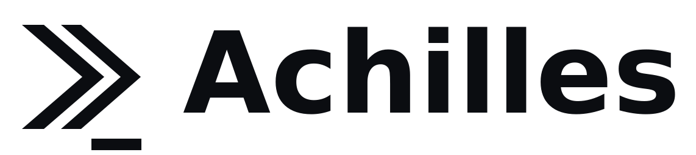

<picture>
  <source media="(prefers-color-scheme: dark)" srcset="../assets/achilles-wordmark-white.svg">
  
</picture>

Achilles name and logo by <a href="https://github.com/56Mugiwara">56Mugiwara</a>, the logo above was made by <a href="https://github.com/Mandrusian">Mandrusia</a>.

We build open-source software and tools.

[Website](https://achilles.mandrusia.tech/) · [Repositories](https://github.com/orgs/achillesorg/repositories)

### Projects

- **[Kiln GNU/Linux](https://github.com/achillesorg/kiln-gnu-linux)** — Debian-based GNU/Linux distribution with the Rust-powered Glaze desktop environment.
- **[GlazeDE](https://github.com/achillesorg/GlazeDE)** — a native Rust and GTK4 Wayland desktop environment for Fedora Linux.
- **[FlowDE](https://github.com/achillesorg/FlowDE)** — experimental Linux mobile desktop and services.

**Achilles** builds open-source software and tools. Kiln GNU/Linux, GlazeDE and FlowDE retain their own project identities.
